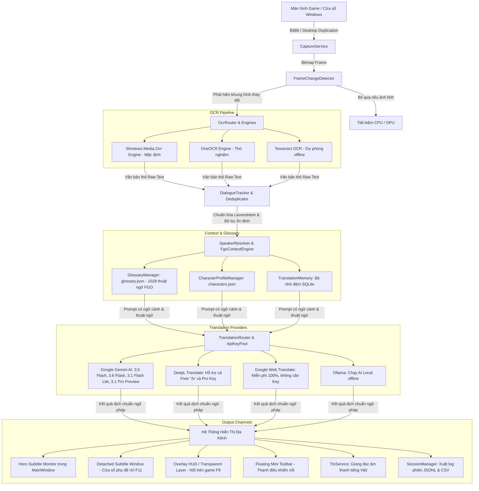

# TBCO (Translate Bot Conversation by OCR) — Toàn Bộ Kiến Trúc & Ngữ Cảnh Dự Án (Agent Context Document)

> **Mục đích tài liệu:** Tài liệu này cung cấp toàn bộ bức tranh kiến trúc, luồng dữ liệu, bản đồ mã nguồn, mô hình cấu hình, quy tắc lập trình và hướng dẫn kiểm thử của dự án **TBCO** để bất kỳ AI Agent hoặc lập trình viên nào cũng có thể nắm bắt và tiếp tục phát triển ngay lập tức mà không cần đào bới lại lịch sử.

---

## 1. TỔNG QUAN DỰ ÁN (PROJECT OVERVIEW)

- **Tên dự án:** TBCO (Translate Bot Conversation by OCR)
- **Phiên bản hiện tại:** `v3.0.2 PRO`
- **Mục tiêu cốt lõi:** Ứng dụng desktop Windows chuyên dụng để **dịch thuật hội thoại thời gian thực (Real-time Dialogue Translation)** cho các tựa game tiếng Nhật/tiếng Anh (đặc biệt tối ưu sâu cho *Fate/Grand Order*, Visual Novels, JRPG, Blue Archive) và các ứng dụng màn hình.
- **Nền tảng công nghệ:**
  - **Framework:** .NET 8.0 Windows Desktop SDK (`net8.0-windows10.0.19041.0`)
  - **Giao diện (UI):** WPF (Windows Presentation Foundation) với XAML + Win32 API Interop
  - **Kiến trúc CPU:** `win-x64`
  - **DPI & Đa màn hình:** Per-Monitor V2 DPI Awareness (`app.manifest`), tương thích màn hình 14 inch, 16 inch (16:10), 2K, 4K và thiết lập đa màn hình ảo.

---

## 2. KIẾN TRÚC LUỒNG DỮ LIỆU ĐẦU-CUỐI (END-TO-END PIPELINE)



---

## 3. CẤU TRÚC THƯ MỤC & BẢN ĐỒ MÃ NGUỒN (CODEBASE MAP)

```text
TBCO/
├── .github/workflows/
│   └── release.yml                 # CI/CD tự động test, build-release và tạo GitHub Release khi push tag v*
├── release/                        # Thư mục chứa gói xuất bản sau khi chạy build-release.ps1
│   ├── TBCO-win-x64/               # Cấu trúc thư mục phát hành 2 tầng
│   │   ├── TBCO.exe                # Trình khởi chạy (Launcher) độc lập tại thư mục gốc
│   │   ├── HUONG_DAN_SU_DUNG.txt   # Hướng dẫn chi tiết bằng tiếng Việt
│   │   └── app/                    # Toàn bộ mã máy, DLL, config và thư viện chạy
│   └── TBCO-win-x64.zip            # File nén zip sạch đẹp người dùng tải về (~80MB)
├── build-release.ps1               # Script PowerShell biên dịch, tối ưu và đóng gói 2 tầng
├── build-release.bat               # Batch script tiện ích chạy build-release
├── publish.ps1                     # Script dotnet publish cơ sở
├── TranslateBot.sln                # Visual Studio / .NET Solution
├── TranslateBot/                   # DỰ ÁN CHÍNH (WPF Desktop App)
│   ├── app.manifest                # Khai báo PerMonitorV2 DPI Awareness cho Windows 10/11
│   ├── App.xaml / App.xaml.cs      # Điểm khởi chạy app, bắt Unhandled Exception toàn cục
│   ├── MainWindow.xaml             # Giao diện chính: Hero Monitor + TabControl cài đặt
│   ├── MainWindow.xaml.cs          # Điều phối chính, Hotkeys, chu kỳ timer quét OCR
│   ├── config.json                 # Cấu hình hiện tại của máy người dùng
│   ├── config.template.json        # File mẫu cấu hình ban đầu
│   ├── glossary.json               # Từ điển 1028 thuật ngữ Fate/Grand Order & Visual Novel
│   ├── characters.json             # Danh sách hồ sơ nhân vật (Servants, Masters)
│   ├── profiles/                   # Game Profile cấu hình sẵn (FGO JP, FGO NA, Blue Archive, VN Generic)
│   ├── tessdata/                   # Thư mục chứa mô hình Tesseract OCR offline (nếu cài đặt)
│   ├── Capture/                    # BẮT HÌNH ẢNH MÀN HÌNH & CỬA SỔ
│   │   ├── CaptureService.cs       # Quản lý chụp màn hình, ghim theo Handle cửa sổ game
│   │   ├── FrameChangeDetector.cs  # Thuật toán so sánh frame: MSE, Histogram, bỏ qua ảnh tĩnh
│   │   ├── WindowEnumerator.cs     # Liệt kê, tìm kiếm cửa sổ game (tiêu đề, tên tiến trình)
│   │   ├── CaptureBufferPool.cs    # Tái sử dụng byte buffer, chống phân mảnh RAM
│   │   └── NativeMethods.cs        # Win32 P/Invoke (BitBlt, PrintWindow, DwmGetWindowAttribute)
│   ├── OCR/                        # BỘ NHẬN DIỆN VĂN BẢN
│   │   ├── IOcrEngine.cs           # Interface chuẩn hóa cho mọi engine OCR
│   │   ├── WindowsOcrEngine.cs     # Windows.Media.Ocr (nhanh, nhẹ, có sẵn trên Win 10/11)
│   │   ├── OneOcrEngine.cs         # OCR nâng cao thử nghiệm
│   │   ├── TesseractOcrEngine.cs   # Tesseract OCR offline dự phòng
│   │   ├── OcrRouter.cs            # Điều phối và chuyển đổi linh hoạt giữa các OCR engine
│   │   ├── OcrAreaManager.cs       # Quản lý nhiều vùng quét OCR trên màn hình
│   │   └── ExclusionManager.cs     # Loại trừ các vùng rác (UI nút bấm, icon game)
│   ├── Translation/                # BỘ ĐIỀU PHỐI DỊCH THUẬT & AI
│   │   ├── ITranslationProvider.cs # Interface chuẩn hóa bộ dịch
│   │   ├── TranslationRouter.cs    # Bộ định tuyến thông minh đa nhà cung cấp (Gemini, DeepL, GoogleWeb, Ollama)
│   │   ├── GeminiProvider.cs       # Google Gemini REST API (Hỗ trợ model 3.5, 3.6, 3.1 Lite/Pro, 2.5)
│   │   ├── Providers/DeepLProvider.cs # DeepL API (tự nhận diện key Free ':fx' hoặc Pro)
│   │   ├── GoogleWebTranslateProvider.cs # Google Dịch Web miễn phí không cần API Key
│   │   ├── ApiKeyPool.cs           # Bể chứa API Key xoay vòng tự động khi chạm Rate Limit
│   │   ├── GlossaryManager.cs      # Tìm kiếm, thay thế thuật ngữ trước và sau khi dịch
│   │   ├── FgoContextEngine.cs     # Bơm ngữ cảnh hội thoại game FGO vào AI Prompt
│   │   └── TranslationMemory.cs    # Cache câu đã dịch vào SQLite để phản hồi 0ms
│   ├── Dialogue/                   # XỬ LÝ HỘI THOẠI & ỔN ĐỊNH VĂN BẢN
│   │   ├── DialogueTracker.cs      # Theo dõi luồng thoại, loại bỏ câu nhảy nhót do animation text
│   │   ├── TextSimilarity.cs       # Đo độ tương đồng Levenshtein Distance
│   │   ├── SpeakerResolver.cs      # Phân tích và tách biệt tên người nói [Tên]: [Lời thoại]
│   │   └── DialogueHistory.cs      # Lịch sử các câu thoại gần nhất để cấp ngữ cảnh cho AI
│   ├── Hotkeys/                    # PHÍM TẮT TOÀN CỤC (GLOBAL HOTKEYS)
│   │   ├── HotkeyManager.cs        # Đăng ký Win32 RegisterHotKey, an toàn tuyệt đối, không gõ nhầm
│   │   ├── HotkeyBinding.cs        # Cấu hình từng phím tắt (F1 - F12, Ctrl combinations)
│   │   └── HotkeyCommand.cs        # Danh mục lệnh phím tắt (Start/Stop, Snapshot, Lock, Detach...)
│   ├── Overlay/                    # PHỤ ĐỀ NỔI TRÊN MÀN HÌNH (OVERLAY HUD)
│   │   ├── OverlayWindow.xaml/.cs  # Cửa sổ trong suốt ghim trên game, hỗ trợ click-through Win32
│   │   └── OverlayStyle.cs         # Preset màu sắc (Studio Dark, Chaldea Navy, High Contrast...)
│   ├── UI/                         # CÁC CỬA SỔ PHỤ TRỢ
│   │   ├── DetachedSubtitleWindow.xaml/.cs # Cửa sổ hiển thị phụ đề độc lập (F11)
│   │   ├── FloatingToolbar.xaml/.cs        # Thanh công cụ mini nổi trên màn hình
│   │   ├── HotkeyCheatsheetWindow.xaml/.cs # Bảng tra cứu phím tắt toàn màn hình (F1)
│   │   ├── ApiKeyManagerWindow.xaml/.cs    # Quản lý bể chứa API Key Gemini & DeepL
│   │   ├── HistoryWindow.xaml/.cs          # Xem và tìm kiếm lịch sử các câu đã dịch
│   │   ├── OcrAreaEditor.xaml/.cs          # Trình biên tập trực quan các vùng quét chữ
│   │   └── WindowSelector.xaml/.cs         # Danh sách chọn nhanh cửa sổ game đang chạy
│   ├── Database/                   # LƯU TRỮ DỮ LIỆU
│   │   ├── IMemoryStore.cs         # Giao diện lưu trữ bộ nhớ
│   │   └── SqliteMemoryStore.cs    # Cơ sở dữ liệu SQLite cục bộ lưu nhật ký và cache
│   ├── Session/                    # QUẢN LÝ PHIÊN CHƠI GAME
│   │   ├── SessionManager.cs       # Tạo phiên, xuất file .jsonl và .csv
│   │   └── SessionRecord.cs        # Cấu trúc bản ghi mỗi câu thoại (thời gian, JP, VI, người nói)
│   ├── TTS/                        # GIỌNG NÓI ĐỌC THOẠI
│   │   └── TtsService.cs           # Đọc to câu dịch bằng giọng Microsoft TTS tiếng Việt
│   └── Infrastructure/             # TIỆN ÍCH HỆ THỐNG
│       ├── ConfigManager.cs        # Đọc / Ghi cấu hình config.json, mã hóa bảo mật key bằng DPAPI
│       ├── TranslationEngine.cs    # Động cơ chính ghép nối Capture + OCR + Router thành vòng lặp
│       └── SnapshotService.cs      # Chụp ảnh tức thì theo phím tắt F8
└── TranslateBot.Tests/             # DỰ ÁN KIỂM THỬ TỰ ĐỘNG (MSTest - 124 Tests)
    ├── ApiKeyPoolAndRouterTests.cs # Kiểm thử bể API Key và định tuyến đa nhà cung cấp
    ├── GameProfileTests.cs         # Kiểm thử tính hợp lệ của Profile và Glossary
    ├── HotkeyTests.cs              # Kiểm thử đăng ký và xung đột phím tắt
    ├── PackagingSanityTests.cs     # Kiểm thử bố cục UI, kích thước màn hình, manifest và packaging
    ├── RouterMultiProviderTests.cs # Kiểm thử DeepL, Gemini, GoogleWeb Translate fallback
    └── SpeakerResolverAndContextTests.cs # Kiểm thử tách tên nhân vật và ngữ cảnh
```

---

## 4. CHI TIẾT CÁC THÀNH PHẦN THEN CHỐT

### 4.1. Hệ Thống Định Tuyến Dịch Thuật Đa Nhà Cung Cấp (`TranslationRouter`)
- **Vị trí:** `TranslateBot/Translation/TranslationRouter.cs`
- **Các Provider hỗ trợ:**
  1. **Google Gemini AI (`GeminiProvider`):**
     - Hỗ trợ đầy đủ danh mục model mới: `gemini-3.5-flash` (mặc định khuyên dùng), `gemini-3.6-flash`, `gemini-3.1-flash-lite`, `gemini-3.5-flash-lite`, `gemini-3.1-pro-preview`, `gemini-2.5-flash`.
     - Tích hợp `ApiKeyPool`: Tự động chuyển key khác khi bị lỗi `429 Too Many Requests` hoặc hết hạn ngạch.
  2. **DeepL Translate (`DeepLProvider`):**
     - Tự động nhận diện Authentication Key: Nếu kết thúc bằng `:fx` dùng endpoint Free (`api-free.deepl.com`), ngược lại dùng endpoint Pro (`api.deepl.com`).
     - Hỗ trợ dịch nhanh chuẩn ngữ pháp tiếng Nhật/Anh sang tiếng Việt.
  3. **Google Web Translate (`GoogleWebTranslateProvider`):**
     - Hoàn toàn miễn phí, không giới hạn số lượng và **không cần API Key**.
     - Hoạt động như lớp bảo hiểm cứu cánh nếu người dùng chưa kịp cài đặt API Key.
  4. **Ollama AI (`OllamaProvider`):**
     - Dành cho người dùng muốn chạy mô hình ngôn ngữ offline hoàn toàn trên máy tính cá nhân.

### 4.2. Từ Điển Thuật Ngữ Chuyên Sâu (`glossary.json`)
- **Quy mô:** Hơn 1.028 thuật ngữ được tối ưu riêng cho game *Fate/Grand Order* và thế giới *Nasuverse* / *Type-Moon* (Holy Grail War, Noble Phantasm, Command Spells, Servant Classes, Lostbelt, Singularities, Chaldea...).
- **Cơ chế hoạt động:**
  - `GlossaryManager` quét văn bản gốc trước khi gửi đến AI.
  - Bơm danh sách cặp thuật ngữ `JP -> VI` tương ứng vào System Prompt của AI.
  - Sau khi dịch, rà soát lại để đảm bảo tên nhân vật và thuật ngữ được giữ đúng chuẩn, không bị dịch ngô nghê theo nghĩa đen thông thường.

### 4.3. Bố Cục Giao Diện Thích Ứng Mọi Kích Thước Màn Hình
- **Cửa sổ chính (`MainWindow.xaml`):**
  - Kích thước mặc định: `Height="680" Width="640"`.
  - Giới hạn tối thiểu linh hoạt: `MinHeight="460" MinWidth="520"`. Cho phép người dùng trên laptop 14 inch thu nhỏ tối đa hoặc chia đôi màn hình (Snap Layout) cạnh cửa sổ game.
  - `Row 2` (Thẻ hiển thị dịch thuật `Hero Subtitle Monitor`): Có `Height="*"` (chiếm >60% diện tích cửa sổ), tích hợp `TranslationScrollViewer` tự động cuộn khi có thoại dài.
  - `Row 4` (TabControl cài đặt): Có `Height="Auto"`, ôm sát vừa vặn nội dung các tùy chọn, loại bỏ hoàn toàn khoảng trống đen lãng phí.
  - Nút bấm sử dụng `WrapPanel`: Tự động xuống dòng ngay ngắn trên màn hình hẹp mà không bị che khuất.
- **Tự động căn chỉnh màn hình (`AdjustWindowForScreenSize` trong `MainWindow.xaml.cs`):**
  - Khi khởi động, app đọc diện tích khả dụng thực tế (`SystemParameters.WorkArea` — đã tự trừ thanh Taskbar).
  - Nếu màn hình nhỏ (như 14 inch 768p hoặc 1080p scale 150%), app tự co chiều cao/rộng lại và căn giữa, **tuyệt đối không bị che khuất bởi Taskbar**.
- **Đa màn hình ảo (Virtual Screen Coordinates):**
  - `DetachedSubtitleWindow.xaml.cs` và `OverlayWindow.xaml.cs` hỗ trợ đầy đủ `VirtualScreenLeft/Top/Width/Height`, cho phép ghim cửa sổ sang màn hình phụ ở bên trái hoặc phía trên màn hình chính (tọa độ âm).

### 4.4. Hệ Thống Phím Tắt Toàn Cục An Toàn (`HotkeyManager`)
- Danh mục phím tắt mặc định:
  - `[F6]`: Bật / Tắt vòng lặp dịch tự động.
  - `[F8]`: Chụp ảnh nhanh và dịch tức thì một vùng quét.
  - `[F9]`: Khóa / Mở khóa phụ đề (chế độ click-through xuyên chuột).
  - `[F11]`: Tách / Gắn lại cửa sổ phụ đề độc lập (`DetachedSubtitleWindow`).
  - `[F1]`: Bật bảng tra cứu nhanh phím tắt toàn màn hình (`HotkeyCheatsheetWindow`).
- **Nguyên tắc an toàn:** Chỉ sử dụng các phím chức năng F1-F12 và tổ hợp bổ trợ (Ctrl/Shift/Alt), không bao giờ đăng ký các phím ký tự thông thường để không làm gián đoạn việc gõ phím của người dùng.

---

## 5. MÔ HÌNH CẤU HÌNH (`config.json`)

Mẫu cấu hình JSON chuẩn được định nghĩa tại `TranslateBot/config.template.json`:

```json
{
  "Version": "3.0.0",
  "AppConfig": {
    "TargetWindowTitle": "",
    "TargetProcessName": "",
    "UseWindowRelativeCapture": true,
    "RelativeCaptureX": 0,
    "RelativeCaptureY": 0,
    "RelativeCaptureWidth": 0,
    "RelativeCaptureHeight": 0,
    "SourceLanguage": "auto",
    "TargetLanguage": "vi",
    "TranslationProvider": "Gemini",
    "AiModel": "gemini-3.5-flash",
    "OcrEngineType": "WindowsOcr",
    "ScanIntervalMs": 300,
    "AlwaysOnTop": false,
    "AutoCopyClipboard": false,
    "TtsEnabled": false,
    "EnableSessionLog": true,
    "AppTheme": "Studio Dark (Mặc định)",
    "OverlayTheme": "FgoChaldea",
    "OverlayMode": "Overlay",
    "DisplayMode": "Both"
  },
  "TranslationProviders": {
    "Gemini": {
      "ApiKey": "",
      "Model": "gemini-3.5-flash",
      "Endpoint": "https://generativelanguage.googleapis.com"
    },
    "DeepL": {
      "ApiKey": "",
      "PlanType": "Auto"
    },
    "GoogleWeb": {
      "Enabled": true
    },
    "Ollama": {
      "Endpoint": "http://localhost:11434",
      "Model": "llama3"
    }
  },
  "Hotkeys": {
    "ToggleBot": "F6",
    "Snapshot": "F8",
    "LockOverlay": "F9",
    "DetachSubtitle": "F11",
    "OpenCheatsheet": "F1"
  }
}
```

*Lưu ý:* Các API Key nhạy cảm khi lưu vào `config.json` sẽ được mã hóa an toàn bằng DPAPI của Windows (`System.Security.Cryptography.ProtectedData`).

---

## 6. ĐÓNG GÓI & PHÁT HÀNH (PACKAGING & RELEASE)

### 6.1. Kiến Trúc Phát Hành 2 Tầng (Two-Tier Distribution)
Để mang lại trải nghiệm chuyên nghiệp, trực quan và không làm người dùng bối rối giữa hàng trăm file DLL của .NET, TBCO được đóng gói theo mô hình 2 tầng:

```text
TBCO-win-x64/
├── TBCO.exe                 # Trình khởi chạy (Launcher) độc lập tại thư mục gốc (~120KB)
├── HUONG_DAN_SU_DUNG.txt    # Hướng dẫn chi tiết bằng tiếng Việt
└── app/                     # Chứa toàn bộ chương trình và thư viện ngầm
    ├── TBCO.exe             # Ứng dụng WPF chính thực thi ngầm
    ├── TBCO.dll             # Thư viện logic
    ├── config.json          # Cấu hình người dùng
    ├── glossary.json        # Từ điển FGO
    ├── profiles/            # Game profiles
    └── ...                  # Các DLL phụ trợ (.NET 8 runtime)
```

Khi người dùng mở `TBCO.exe` ở ngoài cùng, nó sẽ tự động kích hoạt `app\TBCO.exe` với thư mục làm việc chuẩn xác trong `app\`.

### 6.2. Các Lệnh Build & Test Dành Cho Agent
1. **Biên dịch giải pháp:**
   ```powershell
   dotnet build TranslateBot.sln
   ```
2. **Chạy toàn bộ 124 bài kiểm thử tự động:**
   ```powershell
   dotnet test
   ```
3. **Đóng gói file ZIP phát hành đầy đủ:**
   ```powershell
   powershell -ExecutionPolicy Bypass -File build-release.ps1
   ```
   Kết quả sẽ xuất ra tại: `release/TBCO-win-x64.zip` (khoảng 80MB).

4. **CI/CD GitHub Actions:**
   - Khi push tag phiên bản mới dạng `v*` (ví dụ `git tag v3.0.3` && `git push origin v3.0.3`), workflow `.github/workflows/release.yml` sẽ tự động kích hoạt trên GitHub runner `windows-latest`, chạy unit test, đóng gói và tải asset `release/TBCO-win-x64.zip` lên mục **Releases** của repository.

---

## 7. QUY TẮC PHÁT TRIỂN DÀNH CHO CÁC AGENT TIẾP THEO (AGENT GUIDELINES)

Khi được yêu cầu sửa lỗi, nâng cấp hoặc bổ sung tính năng mới cho TBCO, Agent cần tuân thủ nghiêm ngặt các quy tắc sau:

1. **Bảo tồn tính toàn vẹn của WPF Threading:**
   - Mọi thao tác cập nhật giao diện (Label, TextBlock, Window, Brush...) bắt buộc phải chạy trên STA Thread hoặc thông qua `Dispatcher.Invoke(() => { ... })`.
2. **Quy tắc phối màu & Theme DynamicResource:**
   - Không hardcode mã màu trực tiếp trong các Style nếu phần tử đó cần đổi màu theo giao diện Sáng / Tối. Luôn liên kết qua `{DynamicResource Brush*}` (ví dụ: `BrushAppBg`, `BrushCardBg`, `BrushTextPrimary`...).
3. **Quy tắc phím tắt an toàn:**
   - Không được đăng ký phím tắt là các ký tự văn bản đơn lẻ (`A`-`Z`, số, phím Space, Enter). Luôn dùng phím chức năng `F1`-`F12` hoặc tổ hợp với `Ctrl`/`Alt`.
4. **Quy tắc đa kích thước màn hình:**
   - Không bao giờ đặt `Height` cố định lớn hơn 680px hoặc `MinHeight` lớn hơn 500px trên cửa sổ chính.
   - Luôn sử dụng `ScrollViewer` cho các khu vực chứa văn bản dài (như hộp thoại dịch thuật).
   - Sử dụng `WrapPanel` thay vì `StackPanel` nằm ngang cho các cụm nút bấm nhiều phần tử để tự động xuống dòng trên màn hình 14 inch.
5. **Đảm bảo chất lượng bài kiểm thử (100% Passing Tests):**
   - Sau khi hoàn thành bất kỳ chỉnh sửa nào, Agent phải chạy `dotnet test`. Tuyệt đối không để xảy ra bất kỳ bài test nào bị Fail hoặc Warning trước khi bàn giao cho người dùng.
